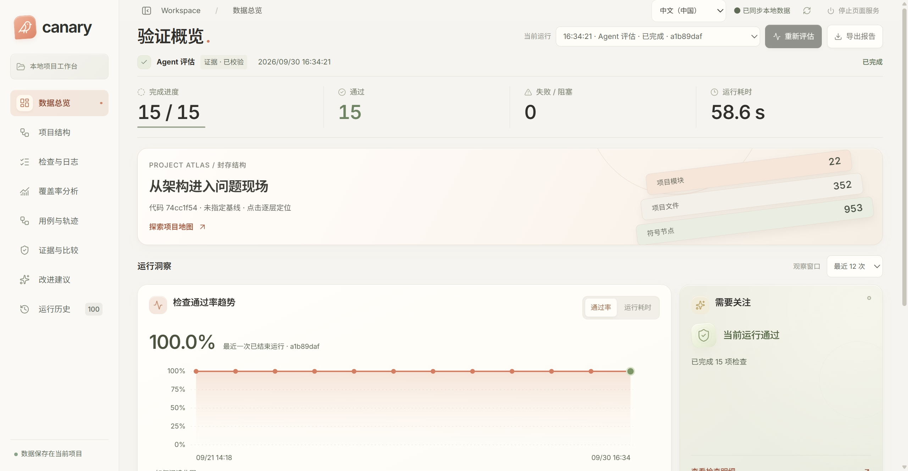

<div align="center">
  
  <h3>评测 Agent 行为，发现回归，验证每一次改进</h3>
  <p>Agent 评测 · 引导式改进 · 交互式架构 · 可追溯证据</p>
  <p><a href="README.md">English</a> · <strong>简体中文</strong></p>
  <p>
    <a href="#快速开始"></a>
    <a href="docs/README.md"></a>
    <a href="docs/roadmap/README.md"></a>
    <a href="https://github.com/EVEDensity/Canary/issues/new/choose"></a>
    <a href="LICENSE"></a>
    <a href="https://nodejs.org/"></a>
    <a href="https://pnpm.io/"></a>
    <a href="https://github.com/EVEDensity/Canary/stargazers"></a>
  </p>
</div>

**Canary 是面向 AI Agent 开发者的评测与持续改进工作台。** 提供 Agent 运行、工具调用校验、轨迹与源码覆盖分析、历史回放和版本比较。通过官方 Skill 理解已记录的问题、查看推荐与可选方案，再验证选定的改进。项目检查、架构地图和 CI 门禁共用同一套证据基础。



## 核心能力

- **Agent 评测** — 按声明用例校验任务输出、工具参数与顺序、状态、终止行为和执行预算。
- **质量简报与决策** — 通过 `canary assess` 查看绑定版本的问题、证据、推荐与备选，并通过 CLI、MCP 或页面记录处理方向。
- **统一检查** — 运行构建、类型检查、lint 与测试，导出 JSON、JUnit 和 Markdown 报告。
- **架构地图** — 在二维结构与三维分层视图中探索模块、文件和符号，搜索节点、过滤依赖、查看源码。
- **失败诊断** — 查看问题分类、脱敏日志和源码位置，关联原始失败、修复后重跑与前后比较。
- **覆盖率联动** — 将采集到的行、函数与分支覆盖映射到结构节点，定位未覆盖范围。
- **可信证据** — 用 manifest、内容哈希和运行谱系关联代码版本、检查结果与历史记录。
- **引导式改进** — 通过[官方 Skill 流程](docs/guides/agent-workflow.md)解释失败、展示推荐与备选方案，再使用 CLI 或 MCP 证据比较已授权的候选。
- **修复交接** — 导出[限定范围的修复任务](docs/guides/repair-tasks.md)，检查候选变更，再收集回归验证证据。
- **变更验证** — 运行时添加 `--base main`，基于封存源码查看[变更覆盖、显式行为与验证缺口](docs/guides/change-verification.md)。
- **修复记忆** — 保留[已验证的修复事实](docs/guides/project-memory.md)，检索同项目的相关历史，并明确源码范围与重新验证条件。

了解[支持范围](docs/guides/support-matrix.md)。

## 快速开始

准备 **Node.js 24 和 Git**，按系统执行一条安装命令：

Canary 通过 GitHub 源码和 Releases 交付，安装器构建所选源码版本，无需 npm 发布或 npm 账号。

**Windows / PowerShell**

```powershell
iwr -useb https://raw.githubusercontent.com/EVEDensity/Canary/main/scripts/install/install.ps1 | iex
```

**macOS / Linux**

```bash
curl -fsSL https://raw.githubusercontent.com/EVEDensity/Canary/main/scripts/install/install.sh | bash
```

安装后新开终端，在项目目录或其子目录执行，无需 Canary 配置：

默认核对正式稳定版。通过 `canary upgrade --check` 检查更新，`canary upgrade` 升级，`canary upgrade --rollback` 恢复上一版本。`canary installation --json` 查看安装提交，`canary installation --verify` 核对运行内容。设置 `CANARY_CHANNEL=main` 可使用开发版。

```bash
canary run --ci                  # 自动识别并执行项目检查
canary run --port 4318 --no-open  # 展示交互式报告
```

打开 [localhost:4318](http://127.0.0.1:4318)。也可从任意目录使用 `canary run --ci --project <项目目录>`。

自动识别 Node 项目的构建、类型检查、lint、格式检查与测试脚本，以及 Python、Go、Rust 的标准测试入口。沿用项目声明的包管理器；项目依赖和测试所需服务需已就绪。详见[自动检查](docs/guides/automatic-checks.md)。

## 项目配置

默认自动发现已有检查。自定义命令、超时和覆盖采集见[配置指南](docs/guides/r4-project-checks.md)。产物保存于项目的 `.canary/`，请加入 `.gitignore`。

## Agent 集成

在项目目录或其子目录安装官方验证 Skill：

```bash
canary skill install
canary skill status --json
```

默认位置是 `.agents/skills/canary-verify`。安装、更新、冲突保护、回滚和撤回使用当前 Node 运行时。Skill 为当前任务收集检查与证据，不授予额外的源码修改、联网或合并许可。其他项目目录及 GitHub Release ZIP 见 [Skill 指南](docs/guides/skills.md)。尚未逐一实测所有 Agent Skills 客户端的发现与调用。

在已加载 Skill 的宿主中提出：**“用现有用例评测这个 Agent，说明主要问题，给出推荐方案和备选项，选择后再修改。”** 明确选择已有 Agent 配置，流程见[评测与引导式改进](docs/guides/agent-workflow.md)。宿主推理使用宿主的模型上下文；被测 Agent 或 Judge 是否产生模型开销，取决于实际调用。

通过 [CLI 指南](docs/guides/cli.md) 进行诊断、复现与验证，或按 [MCP 指南](docs/guides/mcp.md) 将宿主绑定到一个受信任项目。项目经验分别记录选择和 function 适配器上下文实际送达；送达不等于 Agent 采用或产生收益，HTTP/MCP 适配器不注入这些经验。详见[项目经验](docs/guides/r8-project-experience.md)。

## 为什么叫 Canary？

名字源于矿井中的金丝雀：它是危险的早期预警信号。Canary 将这一理念带到软件开发——尽早运行检查，让问题清晰可见，并用可追溯证据验证修复。

**早发现，早检测，让修复有据可查。**

## 文档与参与

- [安装与启动](docs/guides/getting-started.md) · [项目检查](docs/guides/r4-project-checks.md)
- [评估与覆盖率](docs/guides/evaluation-and-coverage.md) · [架构与 CI](docs/guides/architecture-ci.md)
- [GitHub Actions](docs/guides/github-actions.md)：绑定提交版本的 PR 摘要、源码标注与证据下载
- [失败复现](docs/guides/reproduction.md)：独立副本、显式执行与原运行证据关联
- [官方 Skill](docs/guides/skills.md) · [CLI](docs/guides/cli.md) · [MCP](docs/guides/mcp.md)
- [适配器](docs/guides/adapters-and-environment.md) · [目录结构](docs/guides/repository-layout.md)
- [贡献指南](CONTRIBUTING.md) · [翻译贡献](docs/guides/localization.md) · [安全政策](SECURITY.md)

新增语言：`pnpm i18n:add <locale>` 创建草稿，`pnpm i18n:check` 校验翻译契约。审核并合并完整资源后，语言自动出现在界面菜单中。

欢迎提交 Issue、改进文档或贡献代码。完整工作流程见[功能指南](docs/guides/capabilities.md)，后续安排见[路线图](docs/roadmap/README.md)。

## 许可证

[Apache-2.0](LICENSE)。随包字体与图标保留各自许可证声明。
